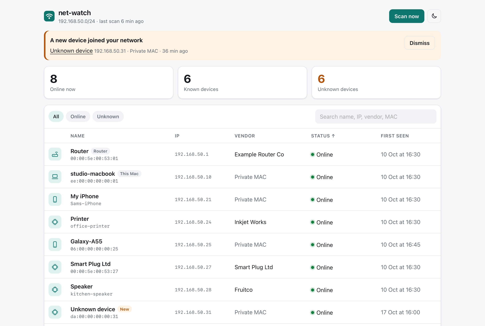
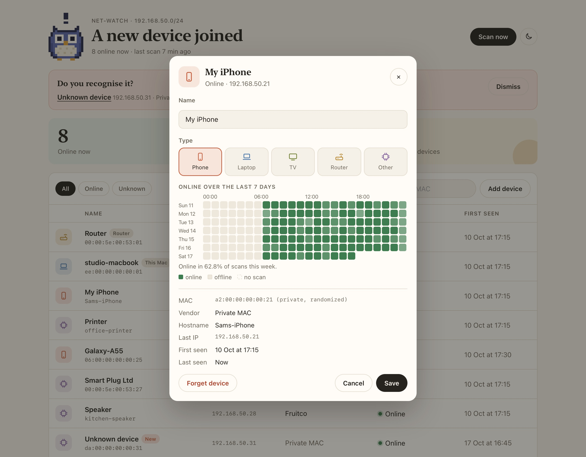
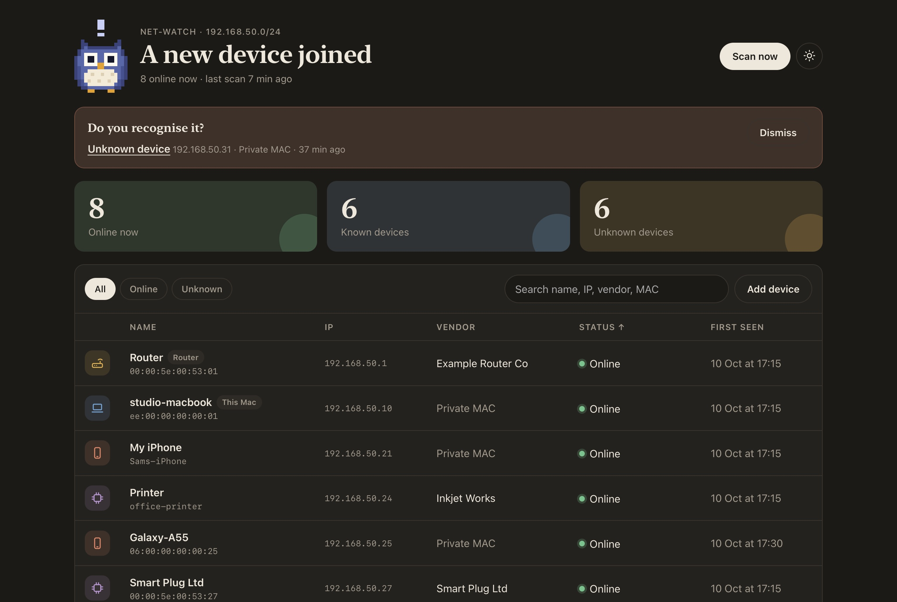
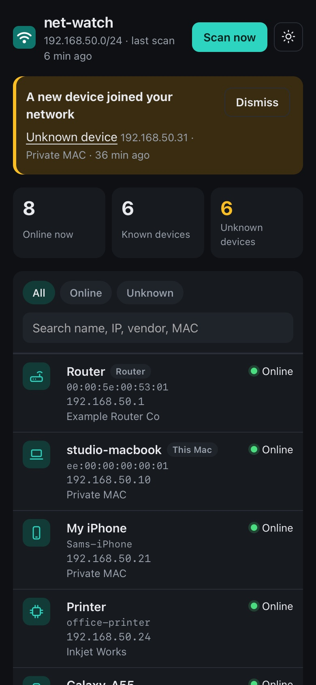
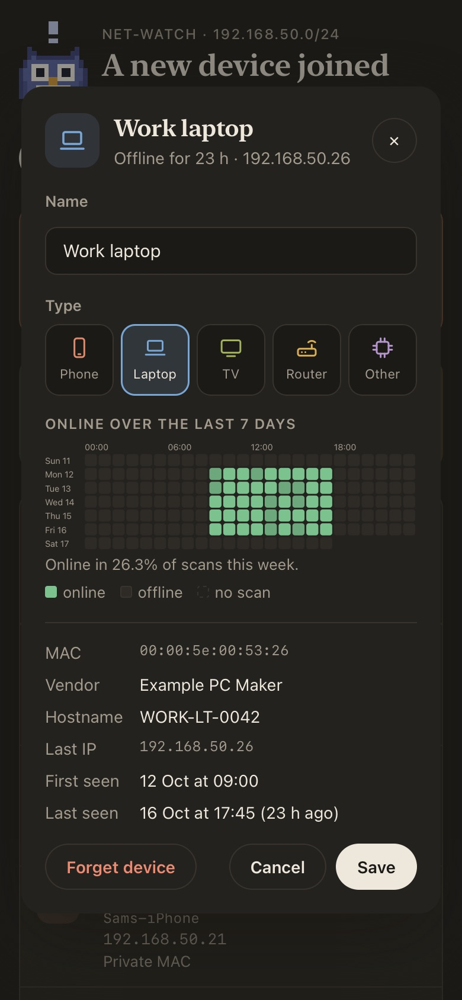

# net-watch

[](https://github.com/amdpaan/net-watch/actions/workflows/tests.yml)

A home network device dashboard for macOS. net-watch scans your home Wi-Fi every few minutes, lists every
device it finds, remembers them, lets you label them and alerts you when an unknown device joins.

Everything runs locally on your Mac. It's free and open source, with no cloud, accounts or paid APIs, and it
uses only the Python that ships with macOS (`/usr/bin/python3`, standard library only).

## Screenshots





<p align="center">
  
  
  
</p>

<sub>Screenshots come from the built-in demo (`netwatch demo`): made-up devices and fake MAC addresses
(the IANA documentation range and invented private addresses).</sub>

## How it works

1. **Which network am I on?** `route -n get default` gives the interface and router IP, `ifconfig` gives
   this Mac's IP and subnet (`ipconfig getifaddr` is the fallback), and the ARP cache gives the router's MAC.
2. **Safety lock.** net-watch only scans the network whose **router MAC** you confirmed as home. On any
   other network (university, café, a friend's place) it does nothing and says so, even if the subnet looks
   the same. It also refuses subnets larger than a /24 and anything outside the private RFC 1918 ranges.
3. **Discovery without sudo.** It sends one ping to every address in the subnet at the same time (64 in
   parallel, a few seconds for a /24). Even devices that ignore pings answer the ARP request that comes
   first, so the Mac's ARP cache fills up, and `arp -an` then lists every device. If `nmap` is installed,
   `netwatch scan --nmap` adds an unprivileged `nmap -sn` pass; it's optional.
4. **Names.** Reverse DNS goes through macOS's mDNSResponder, so it finds names from your router's DNS and
   from Bonjour (`.local`).
5. **Vendors.** The first scan downloads Wireshark's `manuf` file (the IEEE MAC assignments, ~3 MB) once.
   After that, lookups are offline and match the most specific block first (/36, /28, then /24).
   Phones and laptops often use a **private (randomized) MAC**: the "locally administered" bit is set, so
   no vendor owns it. Those show as "Private MAC" instead of "Unknown vendor".
6. **Memory.** Each scan is saved to SQLite: one row per device (label, type, vendor, hostname, first and
   last seen, last IP) and one sighting per device per scan. Sightings older than 90 days are pruned.
   The **first scan is a baseline**: whatever is on your network then counts as already seen, so you don't
   get a burst of alerts. After that, any MAC never seen before is a new device.

7. **Alerts.** When a never-seen MAC shows up, you get a macOS notification (clickable with
   `terminal-notifier`, otherwise through `osascript`). Each device alerts at most once. More than three at
   once become a single summary notification. Phones can rotate their private MAC, so if a new private
   address has the same hostname as a device you've labeled, the alert says "Possibly <that device> with a
   new private address" instead.

8. **Pre-named devices.** Know a device's Wi-Fi address before it joins (a family phone that already
   knows your Wi-Fi, a TV's sticker)? Add it with `netwatch add` or **Add device** in the dashboard. It
   waits under "Waiting to join" and, when it shows up, it's named and typed automatically with no alert.
   Phones with a private address only match while it's set to Fixed for your network.

## Setup

Requirements: macOS (Apple Silicon or Intel) and the built-in `/usr/bin/python3`. Nothing to install.

```sh
git clone https://github.com/amdpaan/net-watch.git ~/Projects/net-watch
cd ~/Projects/net-watch
ln -sf "$PWD/bin/netwatch" ~/.local/bin/netwatch   # optional: put it on your PATH
netwatch home    # at home: confirm this network as home (saves the router's MAC)
netwatch scan    # scan once and print a table
```

### Start at login (optional)

```sh
./install.sh --agent               # launchd agent: `netwatch serve` at login, scanning every 5 min
./install.sh --agent --interval 10
./uninstall.sh                     # remove the agent and the command (add --purge to delete your data too)
```

The agent only listens on `127.0.0.1` (never `--lan`) and logs to
`~/Library/Application Support/net-watch/logs/serve.log`. Off your home network every scan is skipped, and
scanning resumes on its own when you get home.

### Local Network permission

macOS asks before an app talks to devices on your network. If the first scan says the pings were blocked,
open **System Settings → Privacy & Security → Local Network** and turn on the app you ran it from
(Terminal, iTerm, ...).

## Commands

```sh
netwatch scan            # one scan, prints a table (asks to confirm home on first run)
netwatch scan --nmap     # also run nmap -sn if installed
netwatch scan --no-notify
netwatch devices         # everything seen so far: online / offline for X, first seen
netwatch devices --online
netwatch label <mac> "Living room TV" --type tv   # types: phone, laptop, tv, router, other
netwatch add <mac> "Mum's phone" --type phone   # name a device before it joins (joins silently)
netwatch expected        # pre-named devices that haven't joined yet
netwatch forget <mac>    # delete a device and its history, or a waiting one (counts as new if it returns)
netwatch update-oui      # refresh the vendor list
netwatch serve           # dashboard at http://127.0.0.1:8765 + a scan every 5 min (--interval N)
netwatch serve --lan     # also open it from your phone on the same Wi-Fi (prints a link with a token)
netwatch demo            # the dashboard with made-up devices, on port 8766 (never scans)
netwatch home            # show the saved home network
netwatch home --reset    # new router? save the current network as home
netwatch home --forget   # forget it (nothing gets scanned until you confirm again)
```

## The dashboard

`netwatch serve` shows cards (online now, known = labeled by you, unknown = not labeled yet), a banner for
devices that joined in the last 24 hours, and a sortable, searchable device table. Click a device to name
it and pick its type (phone, laptop, TV, router, other). Light and dark mode follow your Mac (the button
switches), and the layout works at phone width.

**Who can see it?** By default the server listens on `127.0.0.1` only, and requests must use a localhost
`Host` header, so a website you visit can't reach it through DNS rebinding. With `--lan` other devices on
your Wi-Fi can connect, but only with the token in the printed link. The token then moves into a cookie and
leaves the URL. Without it they can't read anything, let alone edit labels. `--new-token` rotates it.

## For widgets: `/api/summary` and `summary.json`

```sh
curl -s http://127.0.0.1:8765/api/summary
```
```json
{"online": 8, "known": 6, "unknown": 6, "new_today": 1, "last_scan": 1792225800,
 "on_home_network": true, "generated_at": 1792226142}
```

`known` = devices you've labeled, `unknown` = not labeled yet, `new_today` = devices that joined in the last
24 hours and haven't been labeled or dismissed. `on_home_network` is `null` while no scan has run yet.
Every scan also writes the same JSON to `~/Library/Application Support/net-watch/summary.json`. A desktop
widget (e.g. Übersicht) can read that file even when the dashboard isn't running. Keys are only ever
added, never renamed.

Each device's sheet in the dashboard also shows a 7-day × 24-hour strip: how much of each hour's scans saw
it (darker = more), with dashed cells for hours when no scan ran (Mac asleep or away). It comes from
`GET /api/devices/<mac>/timeline`.

## Your data

Everything lives in `~/Library/Application Support/net-watch/` (override with `NETWATCH_HOME`), never in
the repo. `.gitignore` also excludes databases, the vendor cache and raw command captures in case that
folder ever points inside the repo.

## Development

```sh
uvx --python /usr/bin/python3 pytest      # or: /usr/bin/python3 -m pytest
```

Tests parse saved `route`, `ifconfig` and `arp` output in `tests/fixtures/`, so they never touch a real
network. Fixtures only use fake MACs (the IANA documentation range `00:00:5e:00:53:xx` and made-up private
addresses) and the example subnet `192.168.50.0/24`.

## License

MIT
